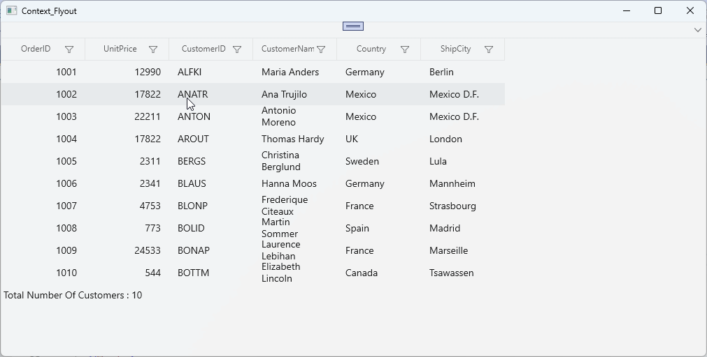

# winui-data-grid-context-flyout
Data Grid provides an entirely customizable context flyout to commonly expose functionality on the user interface. Context flyouts can be created for different rows in an efficient manner.

**XAML**
```xml
xmlns:dataGrid="using:Syncfusion.UI.Xaml.DataGrid"

<dataGrid:SfDataGrid.RecordContextFlyout>
    <MenuFlyout>
        <MenuFlyoutItem Text="Cut" />
        <MenuFlyoutItem Text="Copy" />
        <MenuFlyoutItem Text="Paste" />
        <MenuFlyoutItem Text="Delete" />
    </MenuFlyout>
</dataGrid:SfDataGrid.RecordContextFlyout>
```

**C#**
```csharp
using Syncfusion.UI.Xaml.Core;
using Syncfusion.UI.Xaml.DataGrid;

public class OrderInfoViewModel
{
    public OrderInfoViewModel()
    {
        _gridCopyCommand = new DelegateCommand(Copy);
    }
        
    private DelegateCommand _gridCopyCommand;

    /// <summary>
    /// Gets and sets the copy command
    /// </summary>
    public DelegateCommand GridCopyCommand
    {
        get { return _gridCopyCommand; }
        set { _gridCopyCommand = value; }
    }
    
    /// <summary>
    /// Copy the specified record.
    /// </summary>
    /// <param name="param">
    /// Specifies the <see cref="Syncfusion.UI.Xaml.DataGrid.GridRecordContextFlyoutInfo"/>
    /// </param>
    public void Copy(object param)
    {
        if (param is GridRecordContextFlyoutInfo)
        {	
            var dataGrid = (param as GridRecordContextFlyoutInfo).DataGrid;
            dataGrid.ClipboardController.Copy();
        }
    }
}
```



Take a moment to peruse the [WinUI DataGrid - Context Flyout](https://help.syncfusion.com/winui/datagrid/context-flyout) documentation, to learn more about context flyout with examples.


## Project workflow

1. Open the solution in Visual Studio (the solution file is located in the repository root if present).
2. Restore NuGet packages and ensure Syncfusion WinUI/Data Grid packages are installed.
3. Build and run the project. The sample demonstrates how to attach a context flyout to data grid records and how to handle actions from the flyout.

## Sample details

This example shows how to provide a per-record context flyout for the Syncfusion WinUI Data Grid. The sample demonstrates:

- Declaring a MenuFlyout for the SfDataGrid.RecordContextFlyout in XAML.
- Wiring up commands in a view model to perform clipboard/cut/copy/paste operations from the flyout.
- Retrieving the GridRecordContextFlyoutInfo parameter in command handlers to access the Data Grid instance and the selected record.

The included C# code demonstrates how to implement a simple copy command that uses the grid's ClipboardController to copy the selected record.

## Key files

- `README.md` — this file with usage information and sample explanation.
- Any project/solution files included in the repository (e.g., .sln, .csproj) that build and run the sample.
- View and view-model files that define the Data Grid and the command handlers (usually MainWindow.xaml / MainWindow.xaml.cs or equivalent).

(If your repository contains different paths/names for key files, keep those exact paths here.)

## Requirements

- Visual Studio 2019 or later (or an appropriate IDE that supports WinUI development).
- .NET (appropriate version required by the sample project).
- Syncfusion WinUI Data Grid control packages.

## Support

If you require assistance, please contact the Syncfusion support team at https://support.syncfusion.com/ or open an issue in this repository with details about the problem and reproduction steps.
